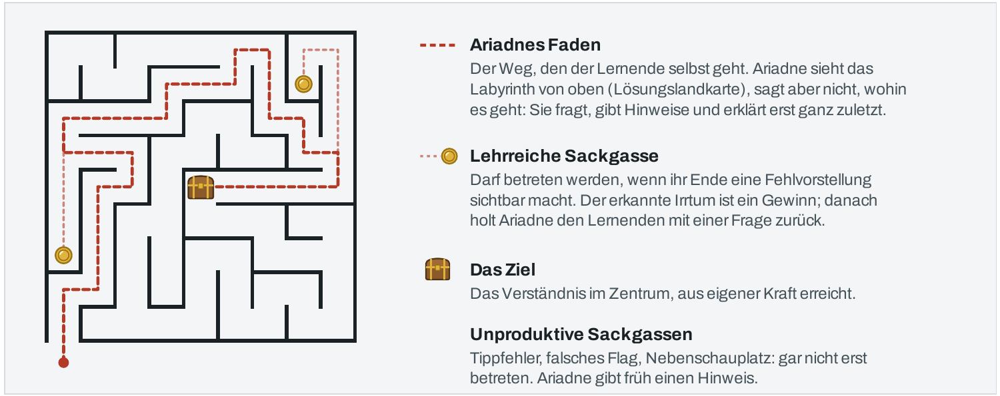
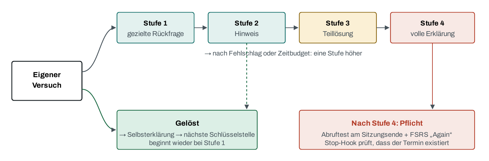

<p align="center">
  
</p>
<p align="center"><sub>Niccolò Bambini: <i>Ariadne und Theseus</i></sub></p>

<h1 align="center">Ariadne</h1>

<p align="center"><b>Ein Lerntutor für Claude Code, der den Weg kennt und ihn trotzdem nicht verrät.</b></p>

<p align="center">
  <a href="konzept/ariadne-lernagent-konzept.pdf">Konzept (PDF, 33 Seiten)</a> ·
  <a href="#so-läuft-das-lernen-ab">Ablauf</a> ·
  <a href="#einrichten">Einrichten</a> ·
  <a href="#grenzen">Grenzen</a>
</p>

Generative KI kann Lernen messbar verschlechtern. Sie kann es auch messbar verbessern.
Welcher Fall eintritt, entscheidet nicht das Modell, sondern das Design drumherum.

**Ariadne** ist ein Tutor-Agent, der die Lernmethoden, deren Wirkung wissenschaftlich am besten belegt ist, konsequent umsetzt.

## Lizenz und Bild

Der Code steht unter der [MIT-Lizenz](LICENSE). Das Konzept in `konzept/` mit PDF, HTML-Fassung und den beiden
Abbildungen steht unter [CC BY 4.0](konzept/LICENSE). Das Titelbild zeigt ein Gemälde von Niccolò Bambini († 1736)
und ist gemeinfrei.

## Lernen mit KI?

**Die Krücke.** In einem Feldexperiment mit knapp tausend Schülern verbesserte ungebremster
GPT-4-Zugang die Übungsnoten um 48 %. In der Prüfung ohne KI schnitten dieselben Schüler danach
17 % schlechter ab als Schüler, die nie KI hatten. Eine Variante, die Hinweise statt Lösungen gab,
hob diesen Schaden weitgehend auf. Beide Gruppen nutzten dasselbe Modell
([Bastani et al. 2025](https://doi.org/10.1073/pnas.2422633122)).

**Die Gegenprobe.** Ein didaktisch gebauter KI-Tutor brachte Harvard-Studierenden im Median mehr als
den doppelten Lernzuwachs von gutem, aktivem Präsenzunterricht, in 49 statt 60 Minuten. Ein Systemprompt
allein reichte dafür nicht: Die Plattform musste die Struktur erzwingen
([Kestin et al. 2025](https://doi.org/10.1038/s41598-025-97652-6)).

Die Frage lautet also nicht „KI ja oder nein“, sondern „welches Design“.

**Ariadne** erfindet dabei kein neues Lernen. Sie macht die Techniken billig, deren Wirksamkeit am besten
belegt ist, die Studierende aber kaum nutzen, weil sie mühsam sind: Abrufübung, verteiltes Wiederholen,
Selbsterklärung, sofortiges Feedback, verschachteltes Üben
([Dunlosky et al. 2013](https://doi.org/10.1177/1529100612453266)).

## Das Prinzip: das Labyrinth

LLMs haben heutzutage ein immenses Fachwissen. Ein Tutor, der mehr weiß als der Schüler, steht aber vor einem Problem: Er kennt die Antwort, aber gerade
die Antwort darf er nicht geben, sonst hätte der Schüler nichts gelernt. Im griechischen Mythos gibt Ariadne Theseus einen Faden. Durch das Labyrinth gehen
muss er selbst.

<p align="center">
  
</p>

Die Denkarbeit bleibt beim Lernenden: generieren, abrufen, selbst erklären.
Ariadne übernimmt Steuerung und Rückmeldung: passende Aufgaben, dosierte Hinweise, sofortiges Feedback,
geplante Wiederholung, sichtbar gemachte Fehlvorstellungen. Dabei „lockt“ sie den Schüler gezielt in Richtung Erkenntnis, die er sich aber immer noch selbst erarbeitet.

Lehrreiche Sackgassen lässt Ariadne zu, unproduktive entschärft sie früh. Wo immer möglich, widerlegt nicht
die KI einen Irrtum, sondern die Maschine: Vorhersage aufschreiben, Code ausführen, vergleichen.

## Struktur gehört in Code, nicht in den Prompt

Das ist die wichtigste Designentscheidung. Was zwingend gelten muss, ist keine Bitte an das Modell,
sondern wird von Hooks und Skripten durchgesetzt. Zahlen zu Aufwand, Terminen, Bestehen und Beherrschung
stehen in Python, das Modell meldet nur Beobachtungen. Alles liegt als Klartext in einem Git-Repo, jede
Änderung am Lernermodell ist ein Commit. Man muss Ariadne nicht vertrauen, man kann nachsehen.

## Was Ariadne kann

### Hinweisleiter statt Lösung

<p align="center">
  
</p>

Jede Schlüsselstelle beginnt mit einem eigenen Versuch. Hilfe kommt stufenweise, nach einem Erfolg geht es
zurück auf Stufe 1, und wer das Zeitbudget überschreitet, steigt eine Stufe auf. „Gib mir einfach die Lösung“
funktioniert immer, wird aber protokolliert, zählt als Stufe 4 und erscheint in der Bilanz. Nach Stufe 4
prüft der Stop-Hook, dass die Wiederholung eingeplant ist.

### Lösungslandkarte

Vor jeder Aufgabe legt Ariadne eine Karte an: Schlüsseleinsichten, typische Fehlvorstellungen, Zeitfallen,
gebunden an das Kursmaterial. Daher kennt sie den Weg, ohne ihn im Gespräch zu erfinden.

### Quellenprüfung jeder Antwort

Jede fachliche Aussage trägt eine Belegklasse:

| Klasse | Form in der Antwort | Bedeutung |
|---|---|---|
| belegt | `⟦"wörtliches Zitat" \| skript.pdf S. 112⟧` | steht wörtlich auf dieser Seite im Material |
| ausgeführt | `⟦lauf: r3⟧` | durch einen protokollierten Lauf geprüft |
| unbelegt | `⟦unbelegt⟧` | Modellwissen, im Text so benannt |

Nach jeder Antwort läuft die Prüfkette. Zuerst vergleicht Python jedes Zitat mit dem Text der angegebenen
Seite: Ein erfundenes Zitat kommt nicht durch, eine Seite ohne prüfbaren Text gilt als „nicht prüfbar“,
nie als „ok“. Danach prüft ein günstiges Zweitmodell (Haiku 5.5) ohne Kenntnis des Gesprächs, ob das Zitat
die Aussage stützt und ob unbelegte Aussagen unmarkiert geblieben sind. Bei „unklar“ eskaliert es an
Sonnet 5.5. Der Hook blockiert fehlerhafte Antworten für höchstens zwei Korrekturrunden; danach erscheint
eine sichtbare Warnung. Eine Antwort erscheint deshalb erst nach der Prüfung und als Ganzes, und von einer
korrigierten Antwort siehst du nur die letzte Fassung, dazu eine Zeile `Stop hook feedback`. Das braucht
Claude Code 2.1.314 oder neuer; ältere Versionen beachten die Rückmeldung nicht. Die verworfenen Entwürfe
bleiben im Sitzungsprotokoll und in der ausführlichen Ansicht (`ctrl+o`) lesbar.

### Lernermodell, das sich nicht schönschreibt

Ein Sprachmodell bewertet Fortschritt gern freundlich. Deshalb blockiert ein Hook jedes direkte Schreiben
in `learner/`. Beherrschung und Wiederholungstermine leitet ein Skript aus beobachtbaren Fakten ab, aus
erreichter Hinweisstufe und Abrufergebnis. Vor jeder Abruffrage nennt der Lernende seine Sicherheit von
1 bis 5, die Bilanz stellt Selbsteinschätzung und Trefferquote gegenüber. So wird die Kompetenzillusion
sichtbar.

### Vorwissensanalyse

Ariadne liest das vorhandene Claude-Code-Gedächtnis, nur lesend, als Hypothesen darüber, was abgefragt
werden sollte. Den Startstand setzen allein Diagnosefragen über feste Regeln: richtig ergibt Beherrschung 2,
nie mehr. Gesperrte Projekte und Gedächtnistypen stehen in `ariadne.toml`.

### Verhandelter Lehrplan

Das Modell gliedert didaktisch, `plan.py` rechnet: Aufwand pro Konzept, Zuschläge für Wiederholung und Puffer,
Termine aus Wochenstunden und Energie, Machbarkeit bis zum Zieldatum. Sagt der Plan „nicht machbar“, wird über
Umfang, Zeit oder Ziel verhandelt, nicht über die Zahlen. Vereinbart ist ein Plan erst mit der wörtlichen
Zustimmung des Lernenden, und der Stop-Hook prüft sie gegen das Gesprächsprotokoll.

### Meilensteine und messbarer Fortschritt

Jeder Meilenstein hat eine Prüfung, bestanden ab einer festen Schwelle (Standard 80 %). Nur der nächste
Meilenstein ist scharf geplant, spätere liegen im Nebel (Idee aus Matt Pococks Wayfinder), bis man weiß, was
wirklich sitzt. `/ariadne:fortschritt` zeigt Ist gegen Soll, den Rückstand in Tagen und die gemessene
Lernzeit. Bei größerem Rückstand schlägt Ariadne eine Neuverhandlung vor.

### Wiederholung, Klausur, Paper

Der FSRS-Algorithmus plant Wiederholungen genau dann, wenn das Vergessen einsetzt, und abgefragt wird durch
Abruf, nie durch erneutes Lesen. Die Klausursimulation mischt Themen und gibt währenddessen keine Hilfe.
Im Forschungsmodus seziert Ariadne Paper mit dir: Fragestellung, Design, Statistik, Aussagekraft.
Literatur sucht sie ausdrücklich nicht, das können Suchmaschinen besser.

### Was Ariadne nie tut

Keine Lösung vor einem eigenen Versuch. Keine Suggestivfragen. Keine bewerteten Abgaben. Kein Urteil über die
Person statt über den Lösungsweg. Keine Literatur, die nicht im Material liegt. Keine Änderung an den eigenen
Regeln.

## So läuft das Lernen ab

```
/ariadne:einrichten                  neues Lern-Repo
/ariadne:einlesen <pdf>              Material zerlegen, Konzepte bestätigen
/ariadne:kapitel                     neues Lernvorhaben: Ziel, Konzepte
  └ /ariadne:vorwissen               Gedächtnis als Hypothesen, Diagnosefragen
  └ /ariadne:plan                    Lehrplan und Zeitplan verhandeln, vereinbaren
/ariadne:lernen <konzept>            Hinweisleiter, Lösungslandkarte, /ariadne:vorhersage
/ariadne:wiederholen                 FSRS, täglich
/ariadne:meilenstein <kapitel> <M>   Zwischenprüfung oder Challenge, messbar
/ariadne:fortschritt                 Ist gegen Soll, Rückstand in Tagen, Lernzeit
/ariadne:bilanz                      Wochenbilanz
/ariadne:klausur  /ariadne:paper     Klausursimulation, Forschungsmodus
```

## Einrichten

Voraussetzungen: Claude Code mit Abo, Linux, macOS oder WSL2, `git`, [`uv`](https://docs.astral.sh/uv/) und
`pdftotext` (poppler). Für Low-Level-Experimente zusätzlich `gcc`, `gdb` und `perf`.
Ariadne spricht Deutsch. Das Konzept ist auf Opus 5.5 als Tutor ausgelegt; es läuft das Modell der Sitzung.

```bash
# einmalig: Plugin aus dem Marketplace installieren und global ausschalten, es wirkt nur in Lern-Repos
claude plugin marketplace add juliantrude/claude-plugins
claude plugin install ariadne@juliantrude --scope user
claude plugin disable ariadne@juliantrude --scope user

# Lern-Repo anlegen: eins pro Person, kursübergreifend
~/.claude/plugins/cache/juliantrude/ariadne/*/bin/ariadne einrichten ~/Documents/uni/ariadne

cd ~/Documents/uni/ariadne && claude
> /ariadne:einlesen material/os/skript.pdf
> /ariadne:kapitel
```

Code und Lerndaten bleiben getrennt. Das Plugin enthält Regeln, Skills, Hooks und Werkzeuge. Das Lern-Repo ist
ein eigenes Git-Repo mit `ariadne.toml`, `learner/`, `material/` und `sitzungen/`, und seine
`.claude/settings.json` aktiviert das Plugin nur dort und schaltet die Eingabevorschläge von Claude Code ab,
weil sie sonst die gesuchte Antwort vorschlagen. Außerhalb eines Lern-Repos schweigen die Hooks.

## Dashboard

`/ariadne:dashboard` oder `ariadne dashboard` im Lern-Repo öffnet den Lernstand im Browser und hält ihn aktuell: Beherrschungsstufen
als Heatmap je Bereich und Kapitel, Schwächen, Plan, Termine, Lernzeit und Selbsteinschätzung. Ein Konzept ab Stufe 3 wackelt, solange
es fällig ist oder eine offene Fehlvorstellung hat. Das Dashboard liest nur.

Gerendert wird es von [md-dashboard](https://github.com/juliantrude/markdown-dashboard). Entweder `md-dashboard` liegt im `PATH`, oder der
Aufruf steht in `ariadne.toml` unter `[dashboard]`, etwa `befehl = "node /pfad/zu/markdown-dashboard/bin/md-dashboard.js"`.

## Grenzen

- **Ariadne ist nicht empirisch untersucht.** Das Konzept begründet, warum sie plausibel wirkt, nicht dass sie
  wirkt. Die Kernstudien stammen aus Schulmathematik und Einführungsphysik und messen überwiegend kurzfristig.
  Wer es bei sich prüfen will, findet in Abschnitt 7.7 des Konzepts einen Selbstversuch.
- **Hart garantiert ist nur die Existenz eines Zitats.** Ob es die Aussage stützt, prüft ein Modell, also nie
  mit Sicherheit. Der Prüfer ist bisher nur an 5 konstruierten Beispielpaaren gelaufen (100 % erkannt, 0 %
  Fehlalarme). Die vorgesehene Validierung mit 50 Paaren aus echtem Material und die 10 begleiteten
  Didaktik-Sitzungen stehen noch aus.
- **Daten gehen an Anthropic.** Ariadne läuft lokal, die Modellaufrufe nicht, und mit ihnen Auszüge aus dem
  Material. Vor dem Einlesen klären, ob die Hochschule das erlaubt. Keine personenbezogenen Daten Dritter ins
  Material.
- **Verbrauch.** Jede Antwort mit Fachaussagen startet zusätzlich einen Prüfaufruf, der aufs Abo zählt.
- **Keine Sandbox.** `run.py` führt Code ohne Isolation aus. Schreibschutz und Hooks sind Leitplanken gegen
  Versehen, keine Sicherheitsgrenze.
- **Lernzeit ist geschätzt** aus Eingabe-Zeitstempeln, Pausen über 15 Minuten zählen nicht, und nicht pro
  Kapitel getrennt. Die Aufwandsschätzung ist ein Startwert, den man nach einigen Wochen nachjustiert.
- **Meilenstein-Items beurteilt das Modell**, über Bestehen entscheidet die Schwelle in `plan.py`.
- **Skills:** Ruft das Modell einen Skill selbst auf, kam im Headless-Test der Inhalt nicht an, als Slash-Befehl
  funktioniert er. Die Regeln enthalten dafür einen Rückfallweg.

## Konzept und Plugin

Das [Konzept](konzept/ariadne-lernagent-konzept.pdf) führt jedes Designelement auf einen Lernmechanismus zurück
und jeden Mechanismus auf veröffentlichte Studien, mit markierter Belegstärke und 29 Quellen. Es ist der
ursprüngliche Entwurf vom Oktober 2026. Das Plugin weicht an drei Stellen davon ab: Der Aufbau ist heute ein
Plugin mit getrenntem Lern-Repo statt eines einzelnen Repos, die Eskalation läuft über Sonnet 5.5 statt Sonnet 5,
und Vorwissensanalyse, verhandelter Lehrplan und Meilensteine sind neu dazugekommen.

## Entwickeln

```bash
uv run pytest                          # ohne Modellaufruf
claude --plugin-dir <pfad-zu-diesem-repo>   # im Lern-Repo: Arbeitsstand ohne Installation testen
```

Eine neue Version braucht eine erhöhte `version` in `.claude-plugin/plugin.json`, danach:

```bash
claude plugin marketplace update juliantrude && claude plugin update ariadne@juliantrude
```

```
.claude-plugin/        plugin.json
regeln.md              Tutor-Regeln, per SessionStart eingespielt
skills/                14 Skills (/ariadne:<name>)
hooks/                 SessionStart, UserPromptSubmit (Lernzeit), PreToolUse (Schreibschutz), Stop (Prüfkette), MessageDisplay (nur Geprüftes zeigen)
bin/ariadne            ein Einstieg für alle Werkzeuge
tools/                 lm plan review run ingest gedaechtnis einrichten validiere_pruefer; Logik in tools/kern/
vorlage/               Inhalt eines neuen Lern-Repos
konzept/               Konzept-PDF, Abbildungen
pruefer-validierung/   Testpaare für den Prüfer (T7)
```

<details>
<summary>Stand der Tests (Nummern wie im Konzept, Abschnitt 8.5)</summary>

| Test | Stand |
|---|---|
| M1 PDF → Seitentexte, leere Seite erkannt | grün (`test_ingest`) |
| T1–T4 Zitatprüfung Ebene ① | grün |
| T5 Schreibschutz learner/ (Edit, Write, Shell) | grün |
| T6 Wiederholungspflicht nach Stufe 4 | grün |
| T7 Prüfer-Validierung | 5 Beispielpaare: 100 % erkannt, 0 % Fehlalarme (Haiku 5.5). **Offen:** 50 Paare aus echtem Material |
| T8 FSRS-Bewertung aus Hinweisstufe | grün |
| T9 Didaktik in 10 begleiteten Sitzungen | **offen** (M5) |
| T10 Transkript lesen | grün, Fixture im Format von Claude Code 2.1.304 |
| T11 Rekursion, max. zwei Korrekturrunden | grün; zusätzlich in einer echten Headless-Sitzung beobachtet |
| Vorwissen, Plan, Verhandlung, Meilensteine, Fortschritt, Lernzeit | grün (`test_planung`, `test_gedaechtnis`) |
| Plugin: Lern-Repo finden, einrichten, Hooks nur im Lern-Repo, Nebel-Meilensteine | grün (`test_plugin`); echte Sitzung: Regeln eingespielt, Skill als Slash-Befehl mit Werkzeugaufruf ohne Rückfrage |

</details>

Concept & Architecture: Julian Trude. Authored with Claude Opus 5.5.
